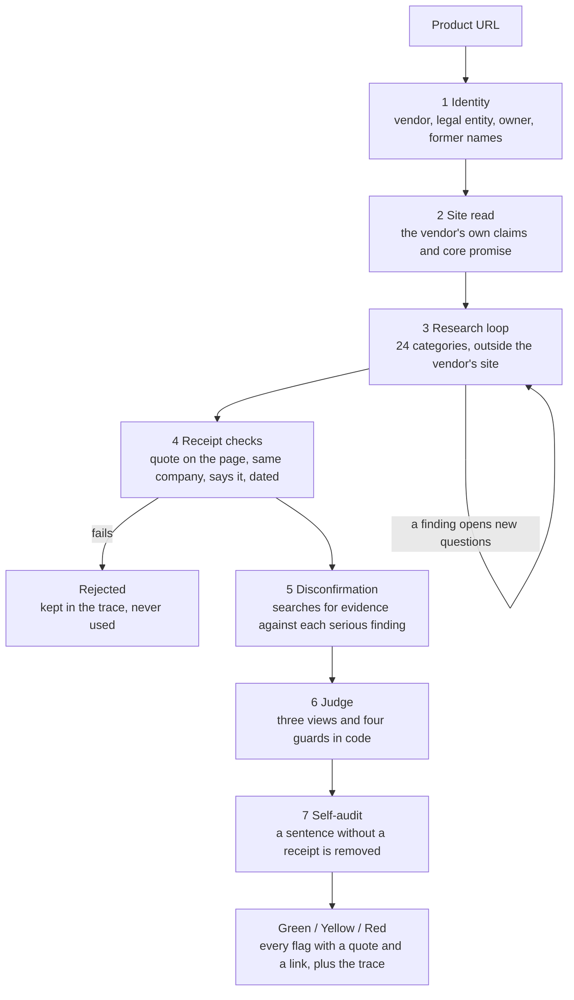

# Vendor Receipts

A vendor's website shows what the vendor wants a buyer to see. Vendor Receipts goes looking for the rest, and it
backs every flag with a quote you can open and check.

## What it does
Give it a vendor URL. It returns a Green, Yellow or Red call in Stackgini's format: green, yellow and red flags plus
the reasoning. Each flag points to a receipt, which is a URL, the verbatim quote from that page, the date of the event
and the kind of source (a regulator, the press, a register, a user review, the vendor itself). Next to the call it
writes a research trace, so a person or an agent can follow how the call was reached and what was searched and not
found.

## How to read `stackgini-verdicts.csv` and `traces/`
`stackgini-verdicts.csv` has one row per product with the columns `id, url, product, vendor, overall, green_flags,
yellow_flags, red_flags, reasoning`. Each flag is written as `text (url)`, and the page at that URL contains the quote
behind it word for word. `traces/<id>.md` holds the full receipt for every flag (quote, date, source type and the
checks it passed), the reasoning with receipt ids such as `[e12]`, the 24-category research matrix, the receipts that
were rejected and why, and the sources that failed to load. The first line of each trace links back to its CSV row.

## How it works

1. Identity. The agent pins down the product, the vendor, the legal entity, the parent company, former names, domains
   and key people. This is where a company with the same name gets ruled out.
2. Site read. It reads up to 15 of the vendor's own pages (about, imprint, customers, pricing, security, privacy,
   terms, changelog, docs, careers) at no more than one request per second and without logging in. It records the
   vendor's claims, its core promise and any place where the site contradicts itself.
3. Research loop. The work is split over a matrix of 24 due-diligence categories, among them ownership and deals,
   lifecycle, release activity, customers, claim checks, regulators, lawsuits, security incidents, sanctions,
   governance and certifications, changes to the terms over time (Wayback snapshots), hosting, technical footprint,
   licence changes, leadership, copied content and platform dependency. Six groups of categories are researched in
   parallel for up to four rounds, and a finding opens new questions: an acquisition leads to the new owner's record,
   a former name to a search under that name. Every category ends as found, searched and not found (the queries are
   listed), or not applicable (with the reason).
4. Checks on every receipt. The quote must really be on the page, the page must be about the same company, the quote
   must support the finding, and the event should carry a date. A receipt that fails one of the first three is
   dropped from the call and kept in the trace with the reason.
5. Disconfirmation. For each serious finding the agent searches for the strongest evidence against it (overturned,
   resolved, a different company).
6. Judge. Three readings of the same receipts (all of them, independent sources only, and a devil's advocate for the
   other color) are reconciled into one call. The color rule has no numeric weights. Four rules are enforced in code
   because a model can break them: no Red without an outside receipt or a proven contradiction on the vendor's own
   site; user reviews are never the only basis of a flag; the look of a site never changes the color; a source that
   failed to load counts as no signal, never as a negative.
7. Self-audit. Any sentence of the reasoning that does not cite a kept receipt is removed.

Tools: Tavily Search and Extract, the Wayback Machine CDX API, crt.sh, DNS over HTTPS, package registries and the
GitHub API. Model: Claude Opus 5.5, high reasoning effort for research and extra-high for checks and the judge.

## Results
The agent never sees Stackgini's labelled examples. No example, flag text or product name is in any prompt or config,
and `make check` fails if one appears. The 40 labelled products were split by a fixed hash into 28 dev and 12 holdout
products before the first run. The holdout ran first from the frozen commit (tag `freeze-2`).

| Set | Vendor Receipts | Everything Yellow | Plain agent (same search results, one call, no checks) |
|---|---|---|---|
| holdout (12) | 8/12 (67%) | 5/12 (42%) | 6/12 (50%) |
| dev (16 of 28) | 11/16 (69%) | 6/16 (38%) | 7/16 (44%) |

No Green product was called Red, on holdout or dev. On holdout the agent found 2 of the 3 Reds and all 5 Yellows, and
1 of the 4 Greens; the other 3 Greens came out Yellow, so it still leans cautious on solid products. Every one of the
269 holdout reasons has a URL. Of 1,616 holdout receipts, 1,435 (89%) passed the checks, and every product ended with
all 24 matrix categories marked found, searched and not found, or not applicable.

How the judge got here. A first change to the judge's wording fixed two dev calls on the products it was written from
and broke two on products it had not seen, so I reverted it. With that frozen judge the holdout scored 7/12 and dev
8/16. Then I wrote one calibration rule from the dev error types (the color follows the strongest receipted finding,
not the number of caveats; a contradicted claim the buyer relies on is critical). I re-judged the same research with
it: dev went from 8/16 to 11/16 and holdout from 7/12 to 8/12, with no call going from right to wrong, so it went in.
Because the holdout helped choose between two judges, read 8/12 as a validation number. The blind batch is the real
test.

Limits. These are small samples. The model already knows many well-known products from training, so part of any
score measures memory; receipts reduce that effect but do not remove it. Twelve dev products were left out to save
search credits. Paywalled and JavaScript-only pages show up as failed sources, never as negatives.

## Run
Python 3.12 or newer, standard library only. `TAVILY_API_KEY` comes from the environment; the model is called
through the `pi` command line (`app/model.py`).
- `make check`: unit tests, the leak test and an offline end-to-end run (under 30 s).
- `make one URL=https://...`: one product; the verdict and trace land under `runs/`.
- `make batch CASES=products.csv OUT=runs/verdicts.jsonl SUBMIT=.`: a batch from a CSV with `id,url,product,vendor`,
  JSONL or one URL per line, written to `stackgini-verdicts.csv` and `traces/`.

## Proof of the blind run
The blind batch ran from tag `blind-run` (4118c9b) with `tools/blind.sh run`. Nothing in `stackgini-verdicts.csv` was
edited by hand.

## Built during the event
Built at AI Agents Berlin, "From Research to Commerce", on 27.11.2026. The product code was written between 16:55 and
19:45 CET (see the commit history). The generic utilities `cache.py`, `llm.py`, `tools/eval.py` and
`tools/prepush.py` and the file templates were prepared before the event and contain no product logic.
